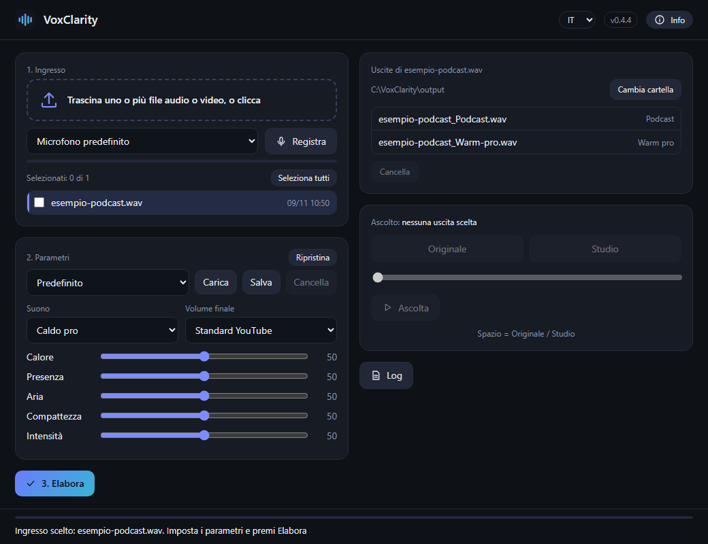

# VoxClarity

[English](README.md)

▶️ **Guardalo:** [video di 2 minuti](https://youtu.be/zEiXBrWEP3E) · [short di 50 secondi](https://youtube.com/shorts/gYPOCjR_cMY)

Porta una registrazione fatta con un microfono economico a un suono da studio, usando l'intelligenza
artificiale sulla scheda video del tuo computer. Trascini un file audio o video (oppure registri dal
microfono), premi **Elabora**, ascolti l'originale e il risultato uno accanto all'altro.



Il motore e' [Sidon](https://github.com/sarulab-speech/Sidon) (Sarulab, Universita' di Tokyo, licenza MIT):
un modello che rigenera la voce da zero a partire da quella registrata. Essendo una risintesi, il
risultato e' vicino all'originale ma non identico: ascolta sempre il confronto prima di usarlo.
Dopo la rigenerazione VoxClarity applica un "suono" a scelta (Caldo pro, Studio caldo, Naturale,
Podcast, Radio), cinque cursori (calore, presenza, aria, compattezza, intensita') e porta il volume
allo standard scelto (YouTube, podcast o livello neutro, senza standard).

## Cosa serve (limiti onesti)

- **Windows 10 o 11, 64 bit.** Non e' stato provato su altri sistemi.
- **Una scheda video NVIDIA con driver 570 o piu' recente.** VoxClarity supporta **solo CUDA
  (NVIDIA)**: i modelli sono compilati per CUDA e il programma non ha altre vie di calcolo. Senza
  scheda NVIDIA il programma si apre, ma la barra di stato segnala che i modelli non sono stati
  caricati e l'elaborazione termina con l'errore "no CUDA device found".
  - **Schede supportate:** dalla generazione Turing (GeForce RTX 20, GTX 16) fino a Blackwell
    (GeForce RTX 50), perche' PyTorch con CUDA 12.8 contiene i kernel per queste architetture. Le
    schede piu' vecchie (GTX 10, Titan V e precedenti) **non** sono supportate da questa versione.
  - **Memoria video:** il file e' elaborato a blocchi di 30 secondi. Misurato (PyTorch 2.11, CUDA 12.8,
    RTX 3080): picco di **circa 2,0 GB** di memoria video allocata su un clip di 30 secondi (un blocco
    intero) e circa 1,4 GB su un'anteprima di 10 secondi; durate maggiori non aumentano il picco. Con
    il driver e il contesto CUDA conviene una scheda con **almeno 4 GB** (provato solo su schede da
    8-10 GB).
- **Python 3.12** (64 bit). `Installa.bat` lo installa da solo se manca (solo per il tuo utente,
  senza diritti di amministratore); altre versioni di Python non sono supportate: i pacchetti sono
  fissati per la 3.12.
- **Spazio su disco:** circa **6 GB in totale** (misurato: `.venv` 4,7 GB, ffmpeg 0,2 GB, modelli
  1,0 GB; PyTorch con CUDA e' grande). I modelli sono scaricati **al primo avvio** da Hugging Face
  (`sarulab-speech/sidon-v0.1` e `facebook/w2v-bert-2.0`, in una revisione precisa; misurato: 1,0 GB
  in totale) e salvati nella cache normale di Hugging Face (`%USERPROFILE%\.cache\huggingface`).
  Serve internet solo per l'installazione e per questo primo scaricamento.
- Google Chrome o Microsoft Edge per la finestra (altrimenti si apre il browser predefinito).

## Installazione (3 passi, senza conoscenze tecniche)

> **Ancora piu' semplice:** scarica `VoxClarity-Setup-x.y.z.exe` dalla
> [pagina Release](https://github.com/AndreaD73/VoxClarity/releases/latest), fai doppio clic e segui la
> procedura guidata (senza diritti di amministratore; si disinstalla da Impostazioni di Windows > App).
> I passi qui sotto usano invece lo ZIP e danno lo stesso risultato.

1. **Scarica** lo ZIP `VoxClarity-x.y.z.zip` dalla
   [pagina Release](https://github.com/AndreaD73/VoxClarity/releases/latest) (sezione "Assets").
2. **Estrailo** in una cartella (clic destro sullo ZIP > **Estrai tutto**). Scegli una cartella
   normale come `C:\Programmi-miei` o Documenti; evita cartelle protette come `C:\Program Files`.
3. **Fai doppio clic su `Installa.bat`**. Fa tutto da solo, senza diritti di amministratore:
   installa Python 3.12 se manca, poi il programma e i suoi componenti (un download grande, diversi GB:
   puo' richiedere molto tempo) e crea l'icona **VoxClarity** sul desktop. Alla fine chiede se
   avviare il programma. Tieni aperta la finestra finche' non dice FATTO.

> **Se Windows mostra una pagina blu "Windows ha protetto il PC"**
> E' Microsoft Defender SmartScreen. Compare perche' il programma e' nuovo e non ancora firmato
> digitalmente, non perche' sia stato trovato qualcosa di sospetto. Clicca **Ulteriori informazioni**
> e poi **Esegui comunque**. Anche il browser puo' dire che il file "non viene scaricato di
> frequente": scegli **Mantieni**. La firma del codice e' prevista (vedi la [politica di firma del codice](CODE_SIGNING.md), in inglese);
> fino ad allora questi avvisi sono normali.

Al **primo avvio** i modelli AI (~1 GB) vengono scaricati: la barra di stato dice "Preparo i
modelli..." e poi "Pronto". Poi avvia il programma con l'icona sul desktop.

### Installazione manuale / avanzata

1. Scarica o clona questa cartella (ad esempio in `C:\Programmi-miei\VoxClarity`; evita cartelle
   protette come `C:\Program Files`).
2. Apri PowerShell nella cartella ed esegui, senza diritti di amministratore:

   ```powershell
   powershell -ExecutionPolicy Bypass -File install.ps1
   ```

   Lo script controlla Python 3.12 e la scheda NVIDIA, crea `.venv` nella cartella, fissa la versione
   di pip e installa i pacchetti: prima PyTorch e torchaudio (CUDA 12.8, solo dall'indice ufficiale
   `https://download.pytorch.org/whl/cu128`, file `requirements-torch.txt`), poi tutto il resto solo da
   PyPI (`requirements.txt`). Le versioni sono esatte e ogni file e' verificato con il suo hash
   SHA-256 (`--require-hashes`): se un file non corrisponde, pip si ferma. Poi scarica ffmpeg e crea
   il collegamento `VoxClarity.lnk` (nella cartella e sul desktop) con l'icona del programma.
3. **ffmpeg:** `install.ps1` scarica una build **LGPL** (non GPL) di una release **datata e fissa**
   (`autobuild-2026-11-08-12-35`) del progetto BtbN FFmpeg-Builds
   (<https://github.com/BtbN/FFmpeg-Builds>) nella cartella `ffmpeg`, **verifica il suo SHA-256**
   confrontandolo con il valore scritto nello script e con i checksum pubblicati da BtbN per quella
   release, e solo dopo la usa; controlla anche che non sia configurata con `--enable-gpl`. Se il
   download o la verifica falliscono (le release datate di BtbN restano online per un tempo limitato)
   usa un ffmpeg gia' presente nel PATH; se non c'e' ti dice cosa installare
   (`winget install Gyan.FFmpeg`).
4. Avvia con un doppio clic su **`VoxClarity.lnk`** o **`VoxClarity.vbs`** (senza finestra nera;
   `VoxClarity.bat` mostra la console per la diagnostica). Al **primo avvio** i modelli vengono
   scaricati (~1 GB): la barra di stato dice "Preparo i modelli..." e poi "Pronto".

Puoi anche trascinare un file sopra `VoxClarity.vbs` per aprirlo gia' selezionato, oppure usare la riga di comando:

```powershell
.venv\Scripts\python voxclarity.py registrazione.wav --preset warm_pro --target youtube
```

## Uso


1. **Ingresso:** trascina uno o piu' file audio/video nel riquadro tratteggiato (o clicca per scegliere),
   oppure scegli il microfono e premi **Registra**. I file trascinati nella finestra sono limitati a
   4 GB ciascuno; per file piu' grandi usa la scelta del file (clic sul riquadro).
2. **Parametri:** scegli suono, volume finale e cursori. Puoi salvare i settaggi con un nome.
3. **Elabora.** Le uscite compaiono nella lista a destra (cartella predefinita
   `Documenti\VoxClarity`, la cartella Documenti vera di Windows, anche se spostata; modificabile).
   L'A/B **Originale / Studio** si ascolta con la barra spaziatrice. I file video mantengono
   l'immagine, cambia solo l'audio.
4. Il pulsante **Info** mostra versione, licenze, "Cerca aggiornamenti" e "Segnala un problema".

**Microfono, la prima volta:** la finestra usa un suo profilo del browser
(`%LOCALAPPDATA%\VoxClarity\browser`) e un indirizzo locale fisso (porta 47811, o un'altra libera se
e' occupata). Premendo **Registra** per la prima volta il browser ti chiede il permesso di usare il
microfono: rispondi "Consenti" e il permesso viene ricordato. Finche' non l'hai dato, l'elenco mostra
solo "Microfono predefinito" (il browser nasconde i nomi dei dispositivi); dopo la prima registrazione
compaiono tutti i microfoni.

## Dove vengono messi i file

| Cosa | Dove |
|---|---|
| Impostazioni (`config.json`, `settings.json`) e log | `%APPDATA%\VoxClarity` |
| File di lavoro (anteprime, registrazioni, caricamenti) | `%LOCALAPPDATA%\VoxClarity` |
| Profilo del browser della finestra (permesso microfono) | `%LOCALAPPDATA%\VoxClarity\browser` |
| Risultati | `Documenti\VoxClarity` (o la cartella scelta) |
| Modelli | cache di Hugging Face, `%USERPROFILE%\.cache\huggingface` |

I dati dell'utente vanno in AppData. Nella cartella di installazione ci sono solo i file del
programma piu' `.venv`, `ffmpeg`, `VoxClarity.lnk` e le cartelle `__pycache__` che Python crea da solo.

## Prestazioni

Misure su un computer con schede NVIDIA da 8 e 10 GB, driver recenti, Windows 11 (un solo computer: i
tuoi numeri varieranno):

- Caricamento dei modelli: da 8 a 15 s a ogni avvio (cache gia' presente); al primo avvio circa 1 minuto
  in piu' per il download di ~1 GB con una connessione veloce.
- Memoria video: picco di circa 2,0 GB su un clip di 30 secondi (un blocco intero), circa 1,4 GB su
  10 secondi; il file viene elaborato a blocchi di 30 secondi, quindi la memoria video non cresce con
  la durata; la memoria RAM invece cresce con la lunghezza del file (l'audio viene caricato per
  intero): per registrazioni di molte ore serve molta RAM.
- Un clip audio sintetico di 30 s e' stato completato in circa 20 s su una scheda condivisa con altri
  programmi, e un file video da 8 s in circa 14 s, compresi lettura e scrittura.

## Privacy e sicurezza

Tutto avviene sul tuo computer. Il server del programma ascolta solo su `127.0.0.1`, accetta solo
richieste dalla finestra che ha aperto (ogni avvio genera un codice segreto casuale nell'indirizzo
della finestra, necessario per ogni richiesta) e **nessun file audio, registrazione o dato personale
viene inviato da nessuna parte**. Le uniche connessioni in rete sono: l'installazione (PyPI,
PyTorch, BtbN), il primo scaricamento dei modelli da Hugging Face (il client della libreria e'
configurato senza telemetria) e il pulsante "Cerca aggiornamenti", che chiede solo a GitHub l'ultima
versione quando lo premi tu.

Il **microfono** viene aperto solo mentre registri, dopo la richiesta di permesso del browser, e
si chiude quando premi Ferma.

Il **log** (`%APPDATA%\VoxClarity\logs`, gli ultimi 10 file giornalieri) contiene i **nomi dei file
elaborati e i percorsi delle cartelle**, che possono includere il tuo nome utente di Windows; non
contiene il contenuto dei file.

"Segnala un problema" apre nel browser una pagina GitHub gia' compilata con versione, versione di
Windows e nome della scheda video, e mostra il file di log: lo allegherai tu, se vuoi, dopo averlo
letto e dopo aver tolto cio' che non vuoi condividere.

## Uso responsabile

VoxClarity serve a **migliorare le tue registrazioni**: la voce resta quella registrata, rigenerata
dal modello con lo stesso testo. **Non e' uno strumento di clonazione vocale** e non genera voci a
partire da testo o da campioni di altre persone. Elabora solo registrazioni di cui hai i diritti e,
se contengono altre persone, il loro consenso. Chi usa il programma e' responsabile del suo uso.

## Licenza

MIT, vedi [LICENSE](LICENSE). Componenti di terzi (Sidon MIT, w2v-BERT 2.0 MIT, FLEURS-R e
LibriTTS-R CC BY 4.0, PyTorch BSD, ffmpeg LGPL, ...): [THIRD_PARTY_NOTICES.md](THIRD_PARTY_NOTICES.md).
Storia delle versioni: [CHANGELOG.md](CHANGELOG.md).
