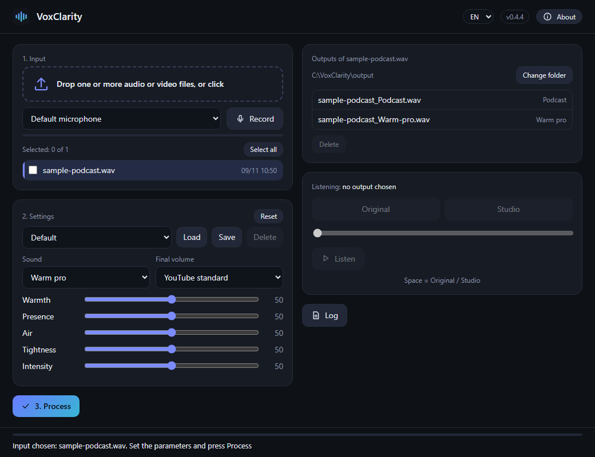

# VoxClarity

[Italiano](README.it.md)

▶️ **Watch it:** [2-minute video](https://youtu.be/2OqR8GS0eqo) · [50-second short](https://youtube.com/shorts/26MZb4qf_l0)

Turns a recording made with a cheap microphone into a studio-sounding one, using AI on your
computer's graphics card. Drag in an audio or video file (or record from the microphone), press
**Process**, and listen to the original and the result side by side.



The engine is [Sidon](https://github.com/sarulab-speech/Sidon) (Sarulab, University of Tokyo, MIT
licence): a model that regenerates the voice from scratch starting from the recorded one. Because it
is a resynthesis, the result is close to the original but not identical: always listen to the
comparison before using it. After regeneration VoxClarity applies a "sound" of your choice (Warm
pro, Warm studio, Natural, Podcast, Radio), five sliders (warmth, presence, air, tightness,
intensity) and brings the loudness to the chosen standard (YouTube, podcast, or a neutral level with
no standard).

## Requirements (honest limits)

- **Windows 10 or 11, 64-bit.** Not tested on other systems.
- **An NVIDIA graphics card with driver 570 or newer.** VoxClarity supports **CUDA (NVIDIA) only**:
  the models are CUDA builds and the program has no other compute path. Without an NVIDIA card the
  program opens, but the status bar reports that the models could not be loaded and processing fails
  with "no CUDA device found".
  - **Supported cards:** from the Turing generation (GeForce RTX 20, GTX 16) up to Blackwell
    (GeForce RTX 50), because PyTorch with CUDA 12.8 contains the kernels for these architectures.
    Older cards (GTX 10, Titan V and earlier) are **not** supported by this version.
  - **Video memory:** the file is processed in 30-second blocks. Measured (PyTorch 2.11, CUDA 12.8,
    RTX 3080): a peak of **about 2.0 GB** of allocated video memory on a 30-second clip (one full
    block) and about 1.4 GB on a 10-second preview; longer files do not raise the peak. With the
    driver and the CUDA context in mind, use a card with **at least 4 GB** (tested only on 8-10 GB
    cards).
- **Python 3.12** (64-bit). `Installa.bat` installs it for you if it is missing (for your user only,
  no administrator rights); other Python versions are not supported: the packages are pinned for 3.12.
- **Disk space:** about **6 GB in total** (measured: `.venv` 4.7 GB, ffmpeg 0.2 GB, models 1.0 GB;
  PyTorch with CUDA is large). The models are downloaded **on first start** from Hugging Face (`sarulab-speech/sidon-v0.1` and
  `facebook/w2v-bert-2.0`, at fixed revisions; measured: 1.0 GB in total) into the normal Hugging
  Face cache (`%USERPROFILE%\.cache\huggingface`). Internet is only needed for the installation and
  this first download.
- Google Chrome or Microsoft Edge for the window (otherwise your default browser opens).

## Installation (3 steps, no technical knowledge needed)

> **Easier still:** download `VoxClarity-Setup-x.y.z.exe` from the
> [Release page](https://github.com/AndreaD73/VoxClarity/releases/latest), double-click it and follow the
> wizard (no administrator rights; uninstall from Windows Settings > Apps). The steps below use the ZIP
> instead and give the same result.

1. **Download** the ZIP `VoxClarity-x.y.z.zip` from the
   [Release page](https://github.com/AndreaD73/VoxClarity/releases/latest) (section "Assets").
2. **Extract** it to a folder (right-click the ZIP > **Extract all**). Choose a normal folder such as
   `C:\Tools` or your Documents; avoid protected ones like `C:\Program Files`.
3. **Double-click `Installa.bat`** ("Install"). It does everything by itself, without administrator
   rights: it installs Python 3.12 if it is missing, then the program and its components (a large
   download, several GB: it can take a long time), and creates a **VoxClarity** icon on your desktop.
   At the end it asks whether to start the program. Keep the window open until it says DONE.

> **If Windows shows a blue page "Windows protected your PC"**
> This is Microsoft Defender SmartScreen. It appears because the program is new and not yet
> digitally signed, not because something was found in it. Click **More info**, then **Run anyway**.
> Your browser may also say that the file "is not commonly downloaded": choose **Keep**.
> Code signing is planned (see the [code signing policy](CODE_SIGNING.md)); until then these warnings are expected.

On the **first start** the AI models (~1 GB) are downloaded: the status bar says "Preparing the
models..." and then "Ready". Start the program afterwards with the desktop icon.

### Advanced / manual installation

1. Download or clone this folder (for example to `C:\Tools\VoxClarity`; avoid protected folders such
   as `C:\Program Files`).
2. Open PowerShell in the folder and run, without administrator rights:

   ```powershell
   powershell -ExecutionPolicy Bypass -File install.ps1
   ```

   The script checks Python 3.12 and the NVIDIA card, creates `.venv` in the folder, pins the pip
   version and installs the packages: first PyTorch and torchaudio (CUDA 12.8, only from the official
   index `https://download.pytorch.org/whl/cu128`, file `requirements-torch.txt`), then everything
   else from PyPI only (`requirements.txt`). Versions are exact and every file is checked against its
   SHA-256 hash (`--require-hashes`): if a file does not match, pip stops. It then downloads ffmpeg
   and creates the `VoxClarity.lnk` shortcut (in the folder and on the desktop) with the program icon.
3. **ffmpeg:** `install.ps1` downloads an **LGPL** build (not GPL) of a **fixed, dated release**
   (`autobuild-2026-11-08-12-35`) of the BtbN FFmpeg-Builds project
   (<https://github.com/BtbN/FFmpeg-Builds>) into the `ffmpeg` folder, **verifies its SHA-256**
   against both the value written in the script and the checksums BtbN published for that release,
   and only then uses it; it also verifies the build was not configured with `--enable-gpl`. If the
   download or the verification fails (BtbN keeps dated releases online for a limited time) it uses
   an ffmpeg already on PATH; if there is none it tells you what to install
   (`winget install Gyan.FFmpeg`).
4. Start by double-clicking **`VoxClarity.lnk`** or **`VoxClarity.vbs`** (no black console;
   `VoxClarity.bat` shows the console for diagnostics). On the **first start** the models are
   downloaded (~1 GB): the status bar says "Preparing the models..." and then "Ready".

You can also drop a file onto `VoxClarity.vbs` to open it preselected, or use the command line:

```powershell
.venv\Scripts\python voxclarity.py recording.wav --preset warm_pro --target youtube
```

## Usage


1. **Input:** drop one or more audio/video files on the dashed box (or click to choose), or pick the
   microphone and press **Record**. Files dropped into the window are limited to 4 GB each; for
   larger files use the file chooser (click the box).
2. **Settings:** choose sound, final volume and sliders. Settings can be saved under a name.
3. **Process.** Outputs appear in the list on the right (default folder `Documents\VoxClarity`, the
   real Windows Documents folder even if it was moved; changeable). Switch **Original / Studio**
   with the space bar. Video files keep their picture; only the audio changes.
4. The **About** button shows version, licences, "Check for updates" and "Report a problem".

**Microphone, the first time:** the window uses its own browser profile
(`%LOCALAPPDATA%\VoxClarity\browser`) and a fixed local address (port 47811, or another free port if
it is busy). The first time you press **Record** the browser asks for permission to use the
microphone: answer "Allow" and the permission is remembered. Until then the list shows only "Default
microphone" (the browser hides device names); after the first recording all microphones appear.

## Where files go

| What | Where |
|---|---|
| Settings (`config.json`, `settings.json`) and logs | `%APPDATA%\VoxClarity` |
| Work files (previews, recordings, uploads) | `%LOCALAPPDATA%\VoxClarity` |
| Browser profile of the window (microphone permission) | `%LOCALAPPDATA%\VoxClarity\browser` |
| Results | `Documents\VoxClarity` (or the folder you choose) |
| Models | Hugging Face cache, `%USERPROFILE%\.cache\huggingface` |

User data goes to AppData. The install folder only holds the program files plus `.venv`, `ffmpeg`,
`VoxClarity.lnk` and the `__pycache__` folders that Python creates by itself.

## Performance

Measured on one computer with 8 GB and 10 GB NVIDIA cards, recent drivers and Windows 11 (your
numbers will vary):

- Model loading: 8 to 15 s at every start (cache already present); on the very first start about
  1 extra minute to download ~1 GB on a fast connection.
- Video memory: peak of about 2.0 GB on a 30-second clip (one full block), about 1.4 GB on 10
  seconds; files are processed in 30-second blocks, so video memory does not grow with duration;
  system RAM does grow with file length (the whole audio is loaded), so recordings of many hours need
  a lot of RAM.
- A synthetic 30 s audio clip finished in about 20 s on a card shared with other programs, and an 8 s
  video file in about 14 s, including reading and writing.

## Privacy and security

Everything happens on your computer. The program's server only listens on `127.0.0.1`, only accepts
requests from the window it opened (every start generates a random secret code in the window's
address, required on every request) and **no audio file, recording or personal data is sent
anywhere**. The only network connections are: the installation (PyPI, PyTorch, BtbN), the first model
download from Hugging Face (the client library is configured without telemetry) and the "Check for
updates" button, which only asks GitHub for the latest version when you press it.

The **microphone** is opened only while you record, after the browser permission prompt, and is
closed when you press Stop.

The **log** (`%APPDATA%\VoxClarity\logs`, the last 10 daily files) contains the **names of the
processed files and folder paths**, which may include your Windows user name; it does not contain the
content of the files.

"Report a problem" opens a pre-filled GitHub page in your browser with the version, Windows version
and graphics card name, and shows the log file: you attach it yourself, if you want, after reading it
and removing whatever you do not want to share.

## Responsible use

VoxClarity is meant to **enhance your own recordings**: the voice stays the recorded one, regenerated
by the model with the same text. It is **not a voice-cloning tool** and does not generate voices from
text or from other people's samples. Only process recordings you have the rights to and, if they
contain other people, their consent. You are responsible for how you use the program.

## Licence

MIT, see [LICENSE](LICENSE). Third-party components (Sidon MIT, w2v-BERT 2.0 MIT, FLEURS-R and
LibriTTS-R CC BY 4.0, PyTorch BSD, ffmpeg LGPL, ...): [THIRD_PARTY_NOTICES.md](THIRD_PARTY_NOTICES.md).
Version history: [CHANGELOG.md](CHANGELOG.md).
